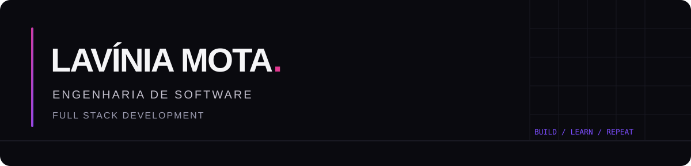
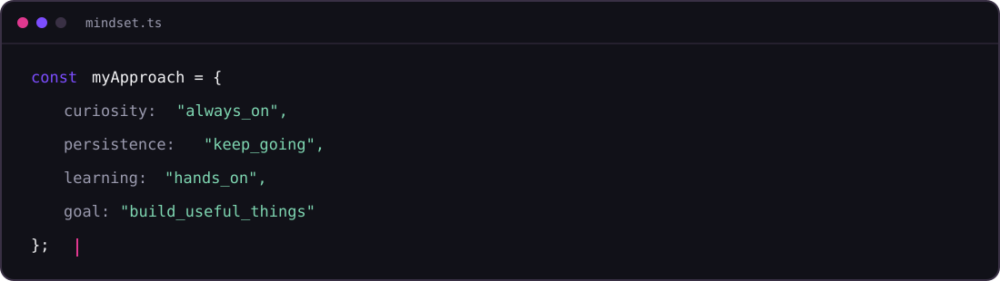
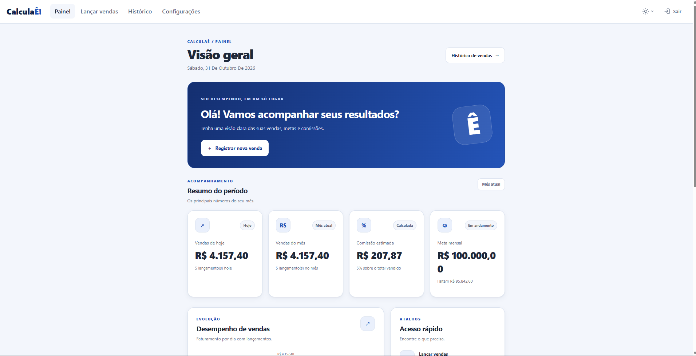
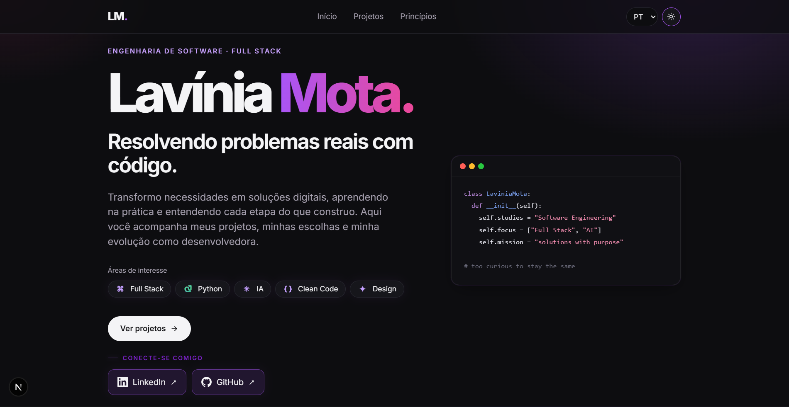
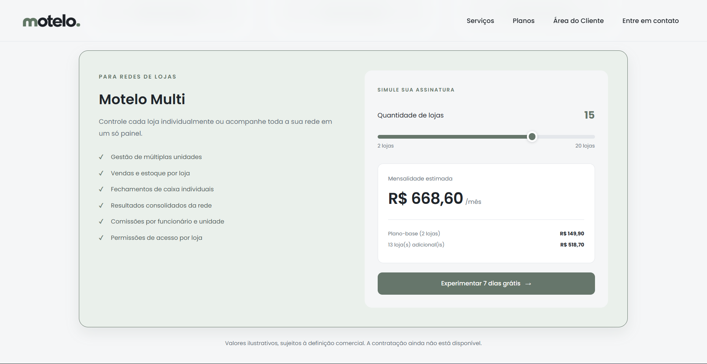

<div align="center">



<a href="https://github.com/laviniamotta">
  
</a>
<a href="https://www.linkedin.com/in/laviniamota/">
  
</a>

</div>

---

## `01` / Sobre mim

Sou estudante de **Engenharia de Software** e desenvolvedora em formação, com foco em **desenvolvimento Full Stack**. Minha trajetória combina tecnologia, criatividade e vontade constante de aprender.

Gosto de entender problemas, pensar em soluções e transformar ideias em aplicações que tenham utilidade no dia a dia. Por isso, desenvolvo projetos próprios desde a concepção e organização dos requisitos até a implementação, buscando evoluir em arquitetura, experiência do usuário, segurança e qualidade de código.

Atualmente, estou aprofundando meus conhecimentos em desenvolvimento web enquanto construo produtos como o CalculaÊ!, o DevFolio e o Motelo.

<details>
<summary><strong>English version</strong></summary>

I am a **Software Engineering** student focused on **Full Stack Development**. My background brings together technology, creativity, and a constant desire to learn.

I enjoy understanding problems, exploring solutions, and turning ideas into applications that are useful in everyday life. I build personal projects from planning and requirements to implementation, continuously improving my skills in architecture, user experience, security, and code quality.

I am currently strengthening my web development skills while building products such as CalculaÊ!, DevFolio, and Motelo.

</details>

## `02` / Em construção

<p align="center">
  
</p>

<div align="center">
  
</div>

## `03` / Stack & ferramentas

<p><sub>TECNOLOGIAS UTILIZADAS NOS PROJETOS</sub></p>

**Frontend**

<p>
  
  
  
  
  
</p>

**Backend & dados**

<p>
  
  
  
  
</p>

**Ambiente de desenvolvimento**

<p>
  
  
</p>

## `04` / Projetos autorais

<table>
  <tr>
    <td width="50%" valign="top">
      <div align="center">
        <h3>CalculaÊ!</h3>
        <p><strong>Comissão sem complicação.</strong></p>
        
      </div>
      <p>Aplicação desenvolvida para simplificar o controle de vendas e o cálculo de comissões. Permite configurar faixas percentuais personalizadas, com regras de enquadramento precisas, sem lacunas ou sobreposição entre intervalos. Os cálculos consideram valores até os centavos e aplicam o percentual correspondente sobre o faturamento elegível.</p>
      <p>Também oferece registro de vendas individuais ou por totais diários, acompanhamento de metas, estimativas de ganhos, indicadores de desempenho e histórico completo de vendas. Uma solução que transforma regras de comissão em informações claras para o vendedor acompanhar seus resultados.</p>
      <p><sub>React · TypeScript · Vite · Supabase · PostgreSQL · CSS</sub></p>
      <p><a href="https://github.com/laviniamotta/Calculae">Ver repositório</a></p>
    </td>
    <td width="50%" valign="top">
      <div align="center">
        <h3>DevFolio</h3>
        <p><strong>Meu portfólio profissional.</strong></p>
        
      </div>
      <p>Plataforma full stack desenvolvida para apresentar minha trajetória, projetos e conhecimentos em um ambiente multilíngue, com suporte a português, inglês e espanhol. O projeto busca oferecer uma experiência de apresentação profissional com identidade visual própria e conteúdo organizado.</p>
      <p>Além da interface pública, a arquitetura prevê um painel administrativo para gerenciar projetos, habilidades e conteúdo do site. O desenvolvimento envolve uma aplicação com Next.js e TypeScript, API REST construída com Python e FastAPI e integração com PostgreSQL.</p>
      <p><sub>Next.js · TypeScript · Python · FastAPI · PostgreSQL · REST API</sub></p>
      <p><sub>Repositório privado · Em desenvolvimento</sub></p>
    </td>
  </tr>
  <tr>
    <td colspan="2" valign="top">
      <div align="center">
        <h3>Motelo</h3>
        <p><strong>Sua loja sob controle.</strong></p>
        
      </div>
      <p>Uma plataforma SaaS de gestão desenvolvida para pequenos varejistas, com foco inicial nos segmentos de moda, acessórios e cosméticos. O Motelo nasce com a proposta de centralizar a operação comercial em um único ambiente, reunindo recursos de gestão e controle para tornar a rotina da loja mais organizada, eficiente e acessível.</p>
      <p>Uma das funcionalidades já desenvolvidas é a calculadora de planos, que permite simular a contratação de acordo com a quantidade de lojas. A proposta do produto também contempla diferentes níveis de acesso (superadmin, gestor, caixa e vendedor), gerenciamento de estabelecimentos e uma estrutura preparada para múltiplas lojas e filiais.</p>
      <p>O projeto considera isolamento de dados entre estabelecimentos, segurança, requisitos da LGPD e uma estrutura comercial baseada em assinaturas, com período de teste e possibilidade de expansão conforme o crescimento do negócio.</p>
      <p>Desenvolvido com frontend em React e TypeScript, backend em Python e FastAPI e persistência em PostgreSQL, o Motelo está sendo construído com foco em organização arquitetural, privacidade e evolução sustentável do produto.</p>
      <p><sub>React · TypeScript · Python · FastAPI · PostgreSQL · SaaS · REST API</sub></p>
      <p><sub>Produto em desenvolvimento · Projeto comercial privado</sub></p>
    </td>
  </tr>
</table>

<details>
<summary><strong>Project descriptions — English</strong></summary>

<h3>CalculaÊ!</h3>
<p><strong>Commission made simple.</strong></p>
<p>An application designed to simplify sales tracking and commission calculations. It allows users to configure custom percentage tiers with precise qualification rules, without gaps or overlaps between ranges. Calculations account for amounts down to the cent and apply the corresponding percentage to eligible revenue.</p>
<p>It also provides individual sales entries or daily sales totals, goal tracking, earnings estimates, performance indicators, and complete sales history. A solution that turns commission rules into clear information, helping salespeople track their results.</p>
<p><sub>React · TypeScript · Vite · Supabase · PostgreSQL · CSS</sub></p>
<a href="https://github.com/laviniamotta/Calculae">View repository</a>

<h3>DevFolio</h3>
<p><strong>My professional portfolio.</strong></p>
<p>A full stack platform developed to showcase my background, projects, and skills in a multilingual environment, supporting Portuguese, English, and Spanish. The project aims to provide a professional presentation experience with its own visual identity and well-organized content.</p>
<p>In addition to the public interface, its architecture is designed to include an administrative panel for managing projects, skills, and website content. The development combines Next.js and TypeScript, a REST API built with Python and FastAPI, and PostgreSQL integration.</p>
<p><sub>Next.js · TypeScript · Python · FastAPI · PostgreSQL · REST API</sub></p>
<p><sub>Private repository · In development</sub></p>

<h3>Motelo</h3>
<p><strong>Your store, under control.</strong></p>
<p>A SaaS management platform developed for small retailers, initially focused on the fashion, accessories, and cosmetics segments. Motelo is designed to centralize business operations in a single environment, bringing together management and control tools to make daily store operations more organized, efficient, and accessible.</p>
<p>One of its implemented features is a plan calculator that allows users to simulate subscription options based on the number of stores. The product is also designed to support different access levels (superadmin, manager, cashier, and salesperson), business management, and multiple stores and branches.</p>
<p>The project takes into account data isolation between businesses, security, LGPD requirements, and a subscription-based business model with a trial period and room for expansion as the business grows.</p>
<p>Built with a React and TypeScript frontend, a Python and FastAPI backend, and PostgreSQL for data persistence, Motelo is being developed with a focus on architectural organization, privacy, and sustainable product evolution.</p>
<p><sub>React · TypeScript · Python · FastAPI · PostgreSQL · SaaS · REST API</sub></p>
<p><sub>Product in development · Private commercial project</sub></p>

</details>


## `05` / Idiomas

<div align="center">

<p>
  <strong>Português</strong>
  &nbsp; | &nbsp;
  <strong>Espanhol</strong>
  &nbsp; | &nbsp;
  <strong>Italiano</strong>
  &nbsp; | &nbsp;
  <strong>Inglês</strong>
</p>
</div>

<details>
<summary><strong>Language skills — English</strong></summary>

<div align="center">

<p>
  <strong>Portuguese</strong>
  &nbsp; | &nbsp;
  <strong>Spanish</strong>
  &nbsp; | &nbsp;
  <strong>Italian</strong>
  &nbsp; | &nbsp;
  <strong>English</strong>
</p>

</div>

</details>

## `06` / Conexões

<div align="center">
  <a href="https://www.linkedin.com/in/laviniamota/">
    
  </a>
  <a href="https://github.com/laviniamotta">
    
  </a>
</div>

<p align="center"><sub>EMAIL PROFISSIONAL</sub></p>

```text
laviniamotadev@gmail.com
```

<div align="center">
  <sub>Disponível para oportunidades remotas | Full Stack Development</sub>
</div>
